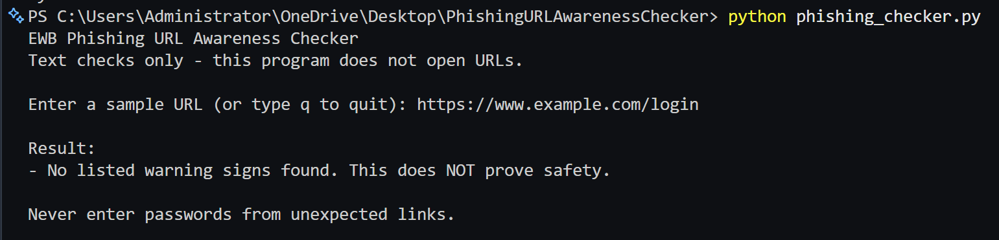
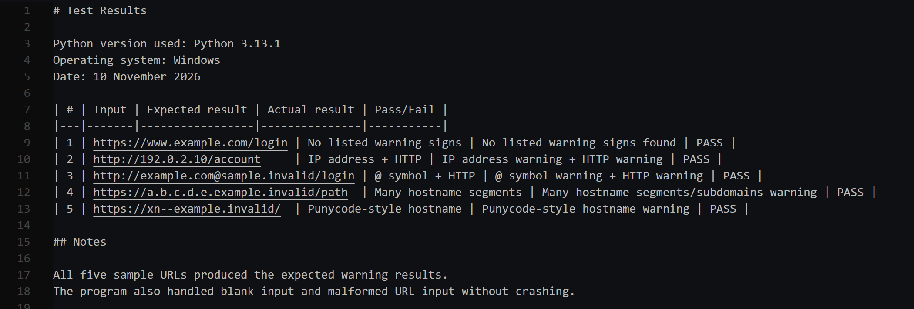

# EWB Phishing URL Awareness Checker

## Overview

Phishing is a type of cyberattack in which attackers use fake or misleading links to trick people into sharing sensitive information. This Python tool checks the text of a URL for common phishing warning signs and displays the results to help users become more aware of suspicious links.

## Features

- Detects an `@` symbol in the URL.
- Flags unusually long URLs (over 100 characters).
- Flags IP-address hostnames.
- Flags many hostname segments (5 or more).
- Flags punycode-style hostnames (`xn--`).
- Flags the HTTP scheme.
- Allows users to check multiple URLs using a repeat/quit option.
- Handles malformed URLs without crashing.

## Requirements

Python 3.10 or later. No extra packages.

## How to Run

**Windows:**
```bash
python phishing_checker.py
```

**Mac/Linux:**
```bash
python3 phishing_checker.py
```

## Example Output

**Input:**
```text
https://www.example.com/login
```

**Result:**
```text
No listed warning signs found.
```

Note: This result does not prove that the website is safe.

## Testing

| # | Input | Expected | Actual | Result |
|---|---|---|---|---|
| 1 | `https://www.example.com/login` | No warning signs | No listed warning signs found | PASS |
| 2 | `http://192.0.2.10/account`     | IP hostname and HTTP warnings | IP address warning + HTTP warning | PASS |
| 3 | `http://example.com@sample.invalid/login` | @ symbol and HTTP warnings | @ symbol warning + HTTP warning | PASS |
| 4 | `https://a.b.c.d.e.example.invalid/path`  | Many hostname segments warning | Many hostname segments/subdomains warning | PASS |
| 5 | `https://xn--example.invalid/` | Punycode warning | Punycode-style hostname warning | PASS |

Additional checks were performed using blank and malformed URL inputs. The program handled them without crashing.

## Screenshots





## Improvements

1. **Repeat/quit loop** - Added an option to check multiple URLs without restarting the program. This makes the tool easier to use. Tested by checking multiple URLs in one session and choosing the quit option.

2. **Malformed URL handling** - Added input validation to handle malformed URLs and prevent the program from crashing. Tested using an invalid URL such as `http://[bad`.

## Limitations

- The tool checks URL text only. It does not visit or scan websites.
- It cannot confirm whether a website is genuinely safe or malicious.
- A URL with no listed warning signs may still be unsafe.
- The tool does not check website content, certificates, or reputation.

## Ethical Use

This project is created for educational and defensive cybersecurity awareness. It uses sample URLs to demonstrate common phishing warning signs. It does not send phishing messages, collect credentials, or scan websites.

## Additional Documents

### Cybersecurity Assessment 01
[View Assessment 01 PDF](documents/EWB-Cybersecurity-Assessment-01-AnkitaBorade.pdf)

### Phishing URL Awareness Checker Workbook
[View Project Workbook](documents/Phishing_URL_Checker_Workbook.pdf)


## Author

**Name:** Ankita Borade  
**GitHub:** AnkitaaBorade  
**Repository:** https://github.com/AnkitaaBorade/phishing-url-awareness